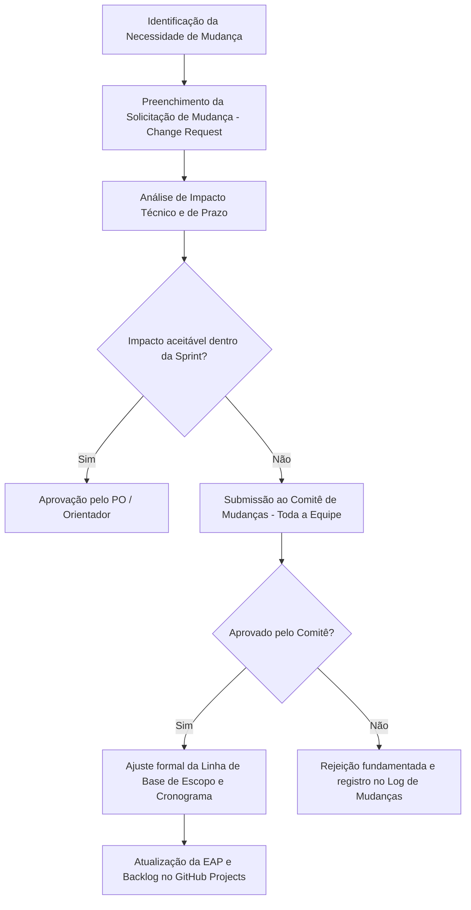

# 📄 Declaração de Escopo do Projeto — FieldOps

---

## 📌 1. Identificação do Projeto

| Campo | Detalhamento |
|---|---|
| **Projeto** | FieldOps — Sistema Integrado de Gestão e Execução de Inspeções em Campo |
| **Área** | Gerenciamento do Escopo do Projeto (PMBOK / SENAI ADS) |
| **Data** | 21/08/2026 (Linha de Base Inicial) |
| **Versão** | 2.0 (Consolidada para Avaliação 1 & 2) |
| **Equipe Responsável** | Pedro (Backend), Murilo (Repo/DevOps), Matheus (Web), Juan (DB), Julio & Gizela (Mobile) |
| **Docente Avaliador** | Prof. Deivison Takatu |

---

## 🎯 2. Justificativa e Objetivos do Produto

O FieldOps surge para sanar a dispersão de dados, atrasos e falhas de auditoria nos processos manuais de inspeções industriais e prediais realizadas em campo. 

### Objetivo do Produto:
Entregar uma plataforma tecnológica unificada com:
1. **Painel Web (Supervisor):** Gestão de modelos dinâmicos de inspeção, agendamento de vistorias, cadastro de equipamentos com QR Code e auditoria/revisão com aprovação/reprovação.
2. **Aplicativo Mobile (Técnico de Campo):** Operação offline-first, captura de fotos/evidências, preenchimento orientado de checklists e sincronização automática idempotente ao reconectar.
3. **Backend & API REST:** Autenticação stateless JWT com RBAC, orquestração de snapshots de templates para garantir imutabilidade jurídica do histórico, e persistência relacional no PostgreSQL.

---

## 🔍 3. Limites do Escopo (Escopo Dentro vs. Escopo Fora)

Para assegurar a viabilidade do projeto no cronograma semestral, foram fixadas as seguintes fronteiras de escopo:

### ✅ 3.1 O que ESTÁ DENTRO do Escopo (Inclusões do Produto)
- **Módulo de Autenticação e Segurança:** Login com credenciais corporativas, emissão de tokens JWT, distinção estrita de perfis (`SUPERVISOR`, `TECNICO`, `ADMIN`).
- **Gestão de Equipamentos:** Cadastro de máquinas/equipamentos com identificador único, código patrimonial, QR Code para leitura rápida e histórico consolidado de inspeções.
- **Construtor Visual de Formulários de Inspeção:** Criação flexível de seções, perguntas de múltipla escolha, texto livre, checklist booleano e obrigatoriedade de fotos para itens não conformes.
- **Mecanismo de Snapshots Imutáveis:** No momento em que uma inspeção é criada ou iniciada, o schema das perguntas é congelado em formato estruturado (JSONB) no banco, garantindo que alterações futuras no template não desfigurem inspeções antigas já auditadas.
- **Agendamento e Atribuição:** Planejamento por calendário, seleção de data/turno e vinculação de um ou mais técnicos a cada atividade de campo.
- **Execução Offline-First Mobile:** Armazenamento local de vistorias em andamento (SQLite / AsyncStorage), fila de sincronização, sincronização de fotos em base64/multipart e reconciliação com o servidor.
- **Workflow de Revisão e Auditoria:** Fluxo formal de aprovação (`EM_REVISAO` ➔ `APROVADO` / `REPROVADO` / `SOLICITADO_CORRECAO`), permitindo ao supervisor devolver a vistoria com apontamentos específicos ao técnico.
- **Dashboard Gerencial:** Indicadores de volume de inspeções por período, taxa de conformidade, equipamentos críticos e técnicos mais atuantes.

---

### ❌ 3.2 O que NÃO ESTÁ DENTRO do Escopo (Exclusões Explícitas)
- Integração legada com sistemas de folha de pagamento ou ponto eletrônico de técnicos de campo.
- Geração de cobrança financeira direta, faturamento ou emissão de notas fiscais pelo software.
- Rastreamento por satélite / geolocalização contínua em tempo real da frota de veículos (será coletada apenas a coordenada GPS estática no momento do envio da inspeção).
- Dispositivos de realidade aumentada (óculos inteligentes AR) para inspeção.
- Treinamento presencial de operadores e técnicos fora do escopo acadêmico do projeto.

---

## 📦 4. Principais Entregas do Projeto (Deliverables)

1. **Documentação de Engenharia e Gestão:** TAP, Matriz de Partes Interessadas, Plano de Comunicações, EAP + Dicionário, Cronograma Gantt com RACI, Plano de Custos, Plano de Qualidade, Matriz de Riscos, Plano de Monitoramento/Controle e Relatório Final.
2. **Infraestrutura e Banco de Dados (Juan & Murilo):** Banco de dados PostgreSQL modelado, normalizado, com migrations versionadas, integridade referencial, índices otimizados e seeds com dados de teste.
3. **Serviços Backend e API REST (Pedro):** Aplicação Spring Boot estruturada em camadas, segurança Spring Security + JWT, documentação Swagger/OpenAPI, rotas RESTful para equipamentos, templates, inspeções e sincronização.
4. **Interface Administrativa Web (Matheus):** Aplicação React + Vite + TailwindCSS com dashboard responsivo, construtor drag-and-drop de formulários e tela de revisão de laudos.
5. **Aplicativo Mobile de Campo (Julio & Gizela):** App React Native com suporte a leitura de QR Code da câmera, cache local offline e sincronização em lote de fotos e respostas.
6. **Deploy e Entrega Contínua (Murilo):** Pipeline no GitHub Actions, conteinerização Docker e ambiente de execução cloud-ready.

---

## 🎯 5. Critérios de Aceitação das Entregas

| Entrega | Critério de Aceitação Mínimo |
|---|---|
| **API REST Backend** | Todos os endpoints com Swagger documentado; autenticação JWT ativa; tempo de resposta < 300ms em requisições de consulta; tratamento uniforme de erros (`400`, `401`, `403`, `404`, `500`). |
| **Banco de Dados** | Schemas criados sem erros de chave estrangeira; suporte nativo a JSONB para snapshots; scripts DDL e DML de seed executáveis em comando único. |
| **Interface Web** | Acesso protegido por rota autenticada; criação e edição de templates funcionando; visualização clara de evidências fotográficas na tela de revisão. |
| **Aplicativo Mobile** | Capacidade comprovada de abrir checklist, preencher respostas e anexar fotos sem qualquer conexão com a internet; sincronização com a nuvem sem duplicação de dados ao reconectar. |
| **Documentação de Gestão** | 100% dos modelos da disciplina de Gestão de Projetos preenchidos com coerência técnica e aderência às regras do SENAI e PMBOK. |

---

## 🔄 6. Processo de Controle Integrado de Mudanças de Escopo

Para evitar o fenômeno de *Scope Creep* (expansão descontrolada de escopo sem ajuste de prazo e recursos), qualquer solicitação de alteração seguirá o seguinte fluxo:

### Regras do Controle de Mudanças:
1. **Nenhuma mudança é implementada informalmente** por conversa direta sem criação de issue e análise prévia.
2. Mudanças de escopo que demandem mais de 8 horas de desenvolvimento de qualquer integrante exigem compensação com remoção ou postergação de itens de menor prioridade do backlog.
3. Todas as alterações aprovadas devem gerar atualização imediata na EAP e na documentação oficial.

---

## ✅ Checklist de Gerenciamento do Escopo

- [x] Contexto e objetivos do produto descritos
- [x] Limites e fronteiras do escopo delimitados
- [x] Inclusões e exclusões expressamente registradas
- [x] Principais entregas e seus critérios de aceitação definidos
- [x] Processo formal de controle de mudanças detalhado
- [x] Consistência com a EAP e o Termo de Abertura (TAP)
