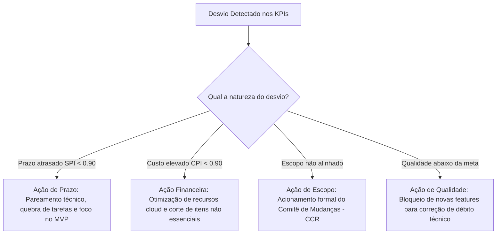

# 📊 Monitoramento, Controle e Encerramento do Projeto — FieldOps

---

## 📌 1. Identificação do Projeto

| Campo | Detalhamento |
|---|---|
| **Projeto** | FieldOps — Sistema Integrado de Gestão e Execução de Inspeções em Campo |
| **Área do Conhecimento** | Monitoramento, Controle e Encerramento do Projeto (PMBOK / SENAI ADS) |
| **Docente Orientador** | Prof. Deivison Takatu |
| **Data de Elaboração** | 21/08/2026 |
| **Data da Revisão** | 06/11/2026 |
| **Versão** | 2.0 (Consolidada para Avaliação 2) |
| **Equipe Responsável** | Pedro (Backend), Murilo (Repo/DevOps), Matheus (Web), Juan (DB), Julio & Gizela (Mobile) |

---

## 🎯 2. Objetivos e Estratégia de Governança

O objetivo deste plano é estabelecer a rotina de acompanhamento das entregas, medir o desempenho do projeto através de indicadores objetivos (KPIs), tratar desvios em relação à linha de base de escopo, prazo, custo e qualidade, e conduzir os ritos formais de homologação, aceite e encerramento administrativo do FieldOps.

---

## 📈 3. Indicadores de Desempenho do Projeto (KPIs)

Para monitorar a saúde do projeto em tempo real, foram instituídos os seguintes indicadores técnicos e de gestão:

| Indicador (KPI) | Objetivo | Fórmula / Método de Coleta | Meta de Desempenho | Frequência de Medição |
|---|---|---|:---:|:---:|
| **SPI (Schedule Performance Index)** | Medir a eficiência do cronograma de desenvolvimento | \( SPI = \frac{VA}{VP} \) (Valor Agregado / Valor Planejado) | \( \ge 0,95 \) | Quinzenal (Sprint) |
| **CPI (Cost Performance Index)** | Medir a eficiência de custos e horas gastas | \( CPI = \frac{VA}{CR} \) (Valor Agregado / Custo Real) | \( \ge 0,95 \) | Quinzenal (Sprint) |
| **Velocidade da Equipe (Sprint Velocity)** | Acompanhar a capacidade de entrega da equipe | Total de Story Points concluídos por Sprint | 25 a 35 pontos/sprint | Fim de cada Sprint |
| **Taxa de Defeitos em Homologação** | Avaliar a densidade de defeitos encontrados antes do release | Número de bugs S1 e S2 abertos na sprint | \( \le 2 \) bugs graves | Semanal |
| **Taxa de Falha de Sincronização Offline** | Medir a resiliência da fila mobile em transição de rede | \( \frac{\text{Falhas de Sync}}{\text{Total de Tentativas}} \times 100 \) | \( < 1,0\% \) | Diário em baterias de teste |
| **Cobertura de Testes Unitários** | Garantir a manutenibilidade e segurança do código backend | Cobertura de linhas reportada pelo JaCoCo | \( \ge 75\% \) | Contínuo (a cada PR no CI) |

---

## ⏰ 4. Frequência e Rituais de Monitoramento

O acompanhamento segue a cadência de eventos da metodologia ágil combinada com o controle formal do PMBOK:

```text
Diário: Daily Standup (15 min no Discord) ➔ Alinhamento de impedimentos
  ↓
Quinzenal: Sprint Review & Demo (Demonstração prática do incremento funcional)
  ↓
Quinzenal: Sprint Retrospective (Análise de processos e planos de ação de melhoria)
  ↓
Mensal / Marcos: Relatório de Desempenho e Reunião de Pauta com Orientador
```

---

## ⚠️ 5. Tratamento de Desvios (Escopo, Prazo, Custo e Qualidade)

Quando os indicadores apontarem variações além dos limites de tolerância, serão disparados os seguintes planos de ação:



### Planos de Contenção Específicos:
1. **Desvio de Prazo:** Se uma entrega atrasar mais de 4 dias, o responsável técnico recebe suporte imediato em sessão de *pair programming* (ex: Pedro apoia Julio na integração de contratos ou Juan apoia Pedro em queries complexas).
2. **Desvio de Qualidade:** Se a cobertura de testes cair abaixo de 70% ou um bug S1 persistir por mais de 12 horas úteis, a esteira de CI do GitHub Actions bloqueia novos merges até a resolução do débito.

---

## 📝 6. Processo Formal de Controle de Mudanças (Change Request - CCR)

Para evitar desvios informais de escopo que comprometam a data final da banca, qualquer solicitação de nova funcionalidade ou alteração técnica segue o fluxo padronizado:

### 📋 Formulário de Solicitação de Mudança (Modelo CCR):
- **Identificador:** CCR-00X
- **Solicitante / Stakeholder:** Nome e papel do interessado.
- **Descrição da Mudança:** O que precisa ser alterado ou adicionado.
- **Justificativa de Negócio / Acadêmica:** Por que a mudança agrega valor ao projeto.
- **Análise de Impacto:**
  - *Impacto no Escopo:* Pacotes da EAP afetados.
  - *Impacto no Prazo:* Estimativa de dias adicionais necessários.
  - *Impacto no Custo:* Horas técnicas ou recursos de nuvem requeridos.
  - *Impacto nos Riscos:* Novos riscos gerados pela modificação.
- **Decisão do Comitê de Mudanças (CCB):** `[ ] APROVADA` | `[ ] REJEITADA` | `[ ] POSTERGADA`
- **Assinatura do Orientador / PO e Líder Técnico:** _____________________

---

## 🏁 7. Critérios de Aceite Formal das Entregas

Cada entrega da EAP só é dada como formalmente aceita mediante o cumprimento cumulativo dos critérios:
1. **Validação Técnica:** Aprovação de 100% dos testes unitários e de integração no GitHub Actions.
2. **Demonstração Operacional:** Apresentação da funcionalidade executando ao vivo sem travamentos perante o supervisor/orientador.
3. **Documentação Atualizada:** Atualização correspondente no Dicionário da EAP, Swagger e manual de uso.
4. **Assinatura de Aceite:** Deferimento no checklist da entrega pelo Prof. Deivison Takatu.

---

## 📜 8. Processo de Encerramento do Projeto

O encerramento do FieldOps será formalizado após a realização da apresentação executiva final e entrega do relatório consolidado, compreendendo os seguintes passos:

### Etapas de Encerramento:
1. **Homologação Final da Versão 1.0 (Release):** Congelamento da tag estável `v1.0.0` no repositório GitHub.
2. **Desativação de Ambientes Temporários e Transição de Recursos:** Desligamento de instâncias de teste na nuvem AWS para evitar cobranças excedentes; arquivamento das credenciais operacionais.
3. **Registro de Lições Aprendidas:** Reunião final da equipe para documentar aprendizados técnicos e comportamentais.
4. **Emissão do Termo de Encerramento do Projeto (TEP):** Formalização acadêmica da conclusão dos trabalhos.

---

## 🎓 9. Termo de Encerramento do Projeto (Modelo Formal - TEP)

```text
================================================================================
                    TERMO DE ENCERRAMENTO DO PROJETO (TEP)
================================================================================
Projeto: FieldOps — Sistema Integrado de Gestão e Execução de Inspeções em Campo
Curso: Tecnologia em Análise e Desenvolvimento de Sistemas — SENAI
Disciplina: Gestão de Projetos | Professor: Prof. Deivison Takatu
Data de Conclusão: 04/12/2026

1. DECLARAÇÃO DE CONCLUSÃO E ENTREGAS REALIZADAS
A equipe declara que as entregas pactuadas no Termo de Abertura do Projeto (TAP) e
na Declaração de Escopo foram integralmente concluídas, testadas e documentadas:
- API REST Backend desenvolvida em Spring Boot com segurança JWT e snapshots JSONB.
- Banco de Dados PostgreSQL implantado com modelagem relacional normalizada e seeds.
- Interface Administrativa Web com dashboard executivo e construtor de formulários.
- Aplicativo Mobile de Campo operante 100% offline com captura de fotos e leitor QR Code.
- Suíte completa de documentos de planejamento, custos, qualidade e riscos.

2. CUMPRIMENTO DOS OBJETIVOS E CRITÉRIOS DE SUCESSO
- Prazo: Entregue rigorosamente dentro do semestre letivo previsto.
- Escopo: 100% das funcionalidades do MVP implementadas sem cortes estruturais.
- Orçamento: Mantido dentro da linha de base com uso de créditos estudantis.
- Qualidade: Software validado em campo em cenário simulado com zero perda de dados.

3. LIÇÕES APRENDIDAS
- Positivas: O uso de snapshots imutáveis em JSONB no banco de dados simplificou
  drasticamente a evolução dos formulários sem quebrar vistorias passadas. A adoção
  de endpoints idempotentes evitou qualquer duplicação durante a sincronização mobile.
- Oportunidades de Melhoria: A antecipação dos contratos de API via Swagger evitou
  retrabalho no frontend; deve ser mantida como prática padrão em projetos futuros.

4. ASSINATURAS E APROVAÇÃO
Equipe Técnica:
___________________________   ___________________________
Pedro (Backend & APIs)        Murilo (DevOps & Governança)

___________________________   ___________________________
Matheus (Frontend Web)        Juan (Banco de Dados)

___________________________   ___________________________
Julio (Frontend Mobile)       Gizela (Frontend Mobile)

Docente Avaliador / Orientador:
_________________________________________________________
Prof. Deivison Takatu
================================================================================
```

---

## ✅ Checklist de Monitoramento e Encerramento (Avaliação 2)

- [x] Indicadores de desempenho (SPI, CPI, Velocidade, Falhas de Sync, Cobertura) definidos
- [x] Frequência e ritos de monitoramento ágeis/PMBOK detalhados
- [x] Planos de ação de contenção para desvios de escopo, prazo, custo e qualidade estabelecidos
- [x] Processo formal de controle de mudanças (CCR) estruturado com modelo de formulário
- [x] Critérios objetivos de aceite das entregas formalizados
- [x] Processo de encerramento do projeto e Termo de Encerramento (TEP) documentados
- [x] Lições aprendidas técnicas e operacionais consolidadas
