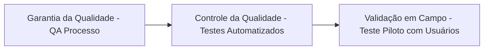

# 🛡️ Plano de Gerenciamento da Qualidade e Aceitação — FieldOps

---

## 📌 1. Identificação do Projeto

| Campo | Detalhamento |
|---|---|
| **Projeto** | FieldOps — Sistema Integrado de Gestão e Execução de Inspeções em Campo |
| **Área do Conhecimento** | Gerenciamento da Qualidade do Projeto (PMBOK / SENAI ADS / ISO/IEC 25010) |
| **Docente Orientador** | Prof. Deivison Takatu |
| **Data de Elaboração** | 21/08/2026 |
| **Data da Revisão** | 06/11/2026 |
| **Versão** | 2.0 (Consolidada para Avaliação 2) |
| **Equipe Responsável** | Pedro (Backend), Murilo (Repo/DevOps), Matheus (Web), Juan (DB), Julio & Gizela (Mobile) |

---

## 🎯 2. Objetivos e Política de Qualidade

A política de qualidade do FieldOps tem como objetivo assegurar que o software entregue satisfaça plenamente os requisitos operacionais de técnicos e supervisores de campo, destacando-se pela **robustez no funcionamento offline**, **integridade jurídica e imutabilidade dos laudos de inspeção**, **segurança no controle de acessos (RBAC/JWT)** e **alta confiabilidade na persistência de dados relacionais**.

---

## 📐 3. Padrões e Requisitos de Qualidade (Norma ISO/IEC 25010)

Para nortear as métricas de qualidade, adotou-se o modelo de qualidade de produto de software da norma **ISO/IEC 25010**:

| Característica ISO 25010 | Requisito Específico no FieldOps | Métrica de Avaliação / Meta de Qualidade |
|---|---|---|
| **Adequação Funcional** | Execução de todo o ciclo de vida da inspeção (criação de modelo, agendamento, vistoria em campo, revisão e aprovação). | 100% dos Casos de Uso críticos (UC01 a UC08) homologados sem divergências funcionais. |
| **Confiabilidade (Tolerância a Falhas)** | Operação ininterrupta do app mobile em áreas sem cobertura de internet móvel, sem perda de respostas ou fotos. | 0% de perda de dados offline durante transição de conexão (modo avião ➔ 4G/Wi-Fi). |
| **Eficiência de Desempenho** | Resposta ágil dos endpoints da API REST e renderização fluida do dashboard Web. | Tempo de resposta de endpoints de consulta < 300ms; renderização inicial da Web < 1,5s. |
| **Usabilidade** | Interface limpa e ergonômica para preenchimento de checklists em campo sob luz solar e com luvas leves. | Taxa de sucesso na primeira tentativa de preenchimento > 90% em testes com usuários reais. |
| **Segurança** | Proteção contra acessos indevidos e adulteração de checklists passados via JWT e snapshots imutáveis. | Senhas criptografadas com BCrypt; zero vulnerabilidades críticas em auditorias de dependências (GitHub Dependabot). |
| **Manutenibilidade** | Código limpo, componentizado, arquitetura em camadas e documentação viva de API. | Cobertura de testes unitários > 75% no backend; conformidade com linters ESLint/Prettier no frontend. |
| **Portabilidade** | Execução responsiva no navegador (Chrome, Edge, Firefox) e compatibilidade móvel (Android 10+ e iOS 15+). | Ausência de quebras de layout em resoluções de smartphone (360x640 até 1080x2400) e desktop. |

---

## 📋 4. Critérios de Aceitação (DoR e DoD)

A equipe estabeleceu critérios estritos de entrada (*Definition of Ready*) e de conclusão (*Definition of Done*) para cada incremento de software:

### 🟢 4.1 Definition of Ready (DoR - Critério de Entrada no Desenvolvimento):
- A história de usuário ou pacote de trabalho possui descrição clara, valor de negócio evidente e critérios de aceite detalhados.
- Contratos de dados (schemas JSON / DDL) acordados entre as frentes envolvidas (ex: Pedro e Julio para novas rotas de vistoria).
- Protótipo de tela ou fluxo de navegação validado.

### 🏁 4.2 Definition of Done (DoD - Critério de Aceite da Entrega):
- Código-fonte revisado e aprovado via Pull Request (Peer Review) por pelo menos um colega de equipe antes do merge.
- Testes unitários implementados e passando com sucesso no pipeline de CI do GitHub Actions.
- Ausência de avisos graves de linter ou vulnerabilidades de segurança conhecidas.
- Funcionalidade testada localmente e integrada ao ambiente unificado.
- Documentação técnica (Swagger/README/Docs de Gestão) atualizada.

---

## 🔍 5. Atividades de Verificação e Validação (Garantia e Controle de Qualidade)

A qualidade é assegurada em três níveis operacionais:



### 1. Nível de Código e Governança (Garantia de Qualidade):
- **Pull Request Review Obrigatório:** Ninguém envia código direto para a branch `main` ou `develop`.
- **Pipeline Automatizado no GitHub Actions:** Murilo configurou verificação automática de build e execução de suíte de testes a cada commit.

### 2. Nível de Testes Automatizados (Controle de Qualidade):
- **Backend (Pedro):** Testes unitários com JUnit 5 e Mockito cobrindo serviços de negócio, gerador de snapshots e cálculo de conformidade; testes de integração com MockMvc validando autorizações RBAC.
- **Banco de Dados (Juan):** Testes de integridade de constraints, foreign keys, triggers e integridade de tipos JSONB no PostgreSQL.
- **Frontend Web (Matheus):** Testes de renderização de componentes com React Testing Library e validação de rotas autenticadas.
- **Mobile (Julio & Gizela):** Testes de ciclo de vida do SQLite local, testes de montagem de telas do checklist e simulação de fila offline.

### 3. Nível de Homologação em Campo (Validação de Aceite):
- **Teste de Campo em Cenário Real (Simulação SENAI):** Teste executado com smartphone em modo avião, preenchimento de vistoria completa em máquina de bancada, registro de 4 fotos em alta resolução, reconexão de rede e verificação da sincronização no painel Web do supervisor.

---

## 👥 6. Papéis e Responsabilidades pela Qualidade

| Frente de Atuação | Responsável Técnico | Atribuição no Controle de Qualidade |
|---|---|---|
| **Backend & APIs** | Pedro | Garantir padrão RESTful, sanitização de inputs, cobertura de testes de serviços e estabilidade do Swagger. |
| **Governança & CI/CD** | Murilo | Garantir pipeline de testes verde, integridade dos branches, versionamento semântico e builds Docker. |
| **Frontend Web** | Matheus | Garantir responsividade, acessibilidade básica, tratamento de erros de API e feedback visual claro ao usuário. |
| **Banco de Dados** | Juan | Garantir integridade referencial, normalização 3FN, índices para consultas rápidas e scripts de seed limpos. |
| **Mobile & Offline** | Julio & Gizela | Garantir persistência sem falhas no SQLite, usabilidade móvel, foco da câmera e fila assíncrona tolerante a quedas. |
| **Liderança Geral de QA** | Murilo & Pedro | Homologação final dos pacotes da EAP e aprovação formal dos critérios de aceite perante o orientador. |

---

## 🛠️ 7. Fluxo de Tratamento de Não Conformidades e Defeitos (Gestão de Bugs)

Quando um defeito ou não conformidade técnica for identificado durante os testes ou homologação, ele será classificado e tratado conforme a matriz de severidade:

| Nível de Severidade | Definição | Exemplo Prático | SLA Máximo de Correção | Ação Mandatória |
|---|---|---|:---:|---|
| **S1 — Crítico (Bloqueante)** | Impede o funcionamento de um fluxo principal do sistema; causa perda de dados ou falha de segurança. | Perda de fotos offline ao fechar o app móvel; erro 500 no login do supervisor. | Até 12 horas úteis | Interrupção imediata de novas tarefas do responsável para correção imediata (*Hotfix*). |
| **S2 — Alto** | Funcionalidade relevante falha, mas existe contorno manual alternativo. | Falha ao exportar PDF de vistoria; lentidão de 3 segundos na consulta de equipamentos. | Até 36 horas úteis | Inclusão prioritária no topo da Sprint corrente. |
| **S3 — Médio** | Comportamento inesperado menor que não inviabiliza o fluxo principal. | Mensagem de validação de formulário com texto truncado; alinhamento de botão torto na Web. | Próxima Sprint | Registro no backlog de melhorias e correções. |
| **S4 — Baixo / Cosmético** | Inconsistência puramente estética ou de digitação. | Variação de tonalidade de cinza no card; erro ortográfico em dica de tela. | Sob demanda | Correção em pacote de refinamento visual. |

### Fluxo de Ciclo de Vida do Defeito:
```text
Bugs Identificados (GitHub Issue com tag 'bug')
                 ↓
Análise de Causa Raiz pelo Líder da Frente
                 ↓
Correção em branch dedicada 'fix/nome-do-bug'
                 ↓
Revalidação do Teste Automatizado + Teste Manual
                 ↓
Aprovação via Pull Request e Fechamento da Issue
```

---

## ✅ Checklist do Plano de Qualidade (Requisitos da Avaliação 2)

- [x] Padrões de qualidade da ISO/IEC 25010 integrados e mapeados para o FieldOps
- [x] Critérios de aceitação definidos (Definition of Ready e Definition of Done)
- [x] Atividades de verificação estática (Code Review/CI) e validação dinâmica detalhadas
- [x] Responsáveis pela qualidade claramente designados para cada módulo da arquitetura
- [x] Matriz de severidade de defeitos (S1 a S4) com SLAs de atendimento estipulados
- [x] Fluxo completo de tratamento e contenção de não conformidades estabelecido
